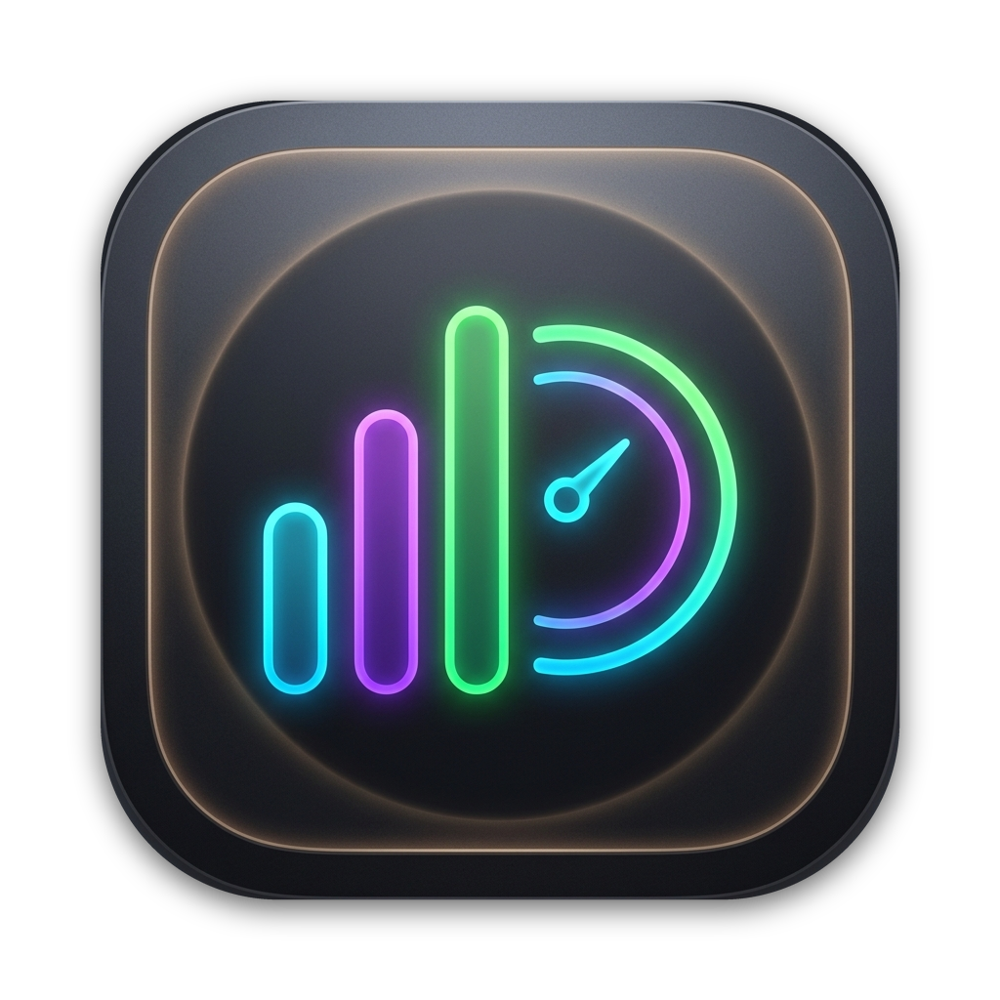
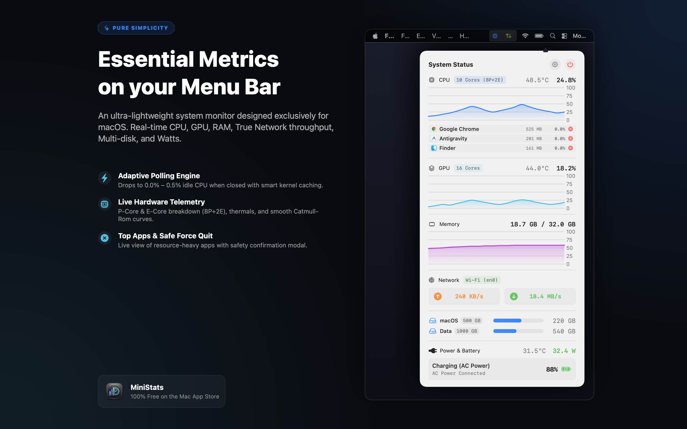
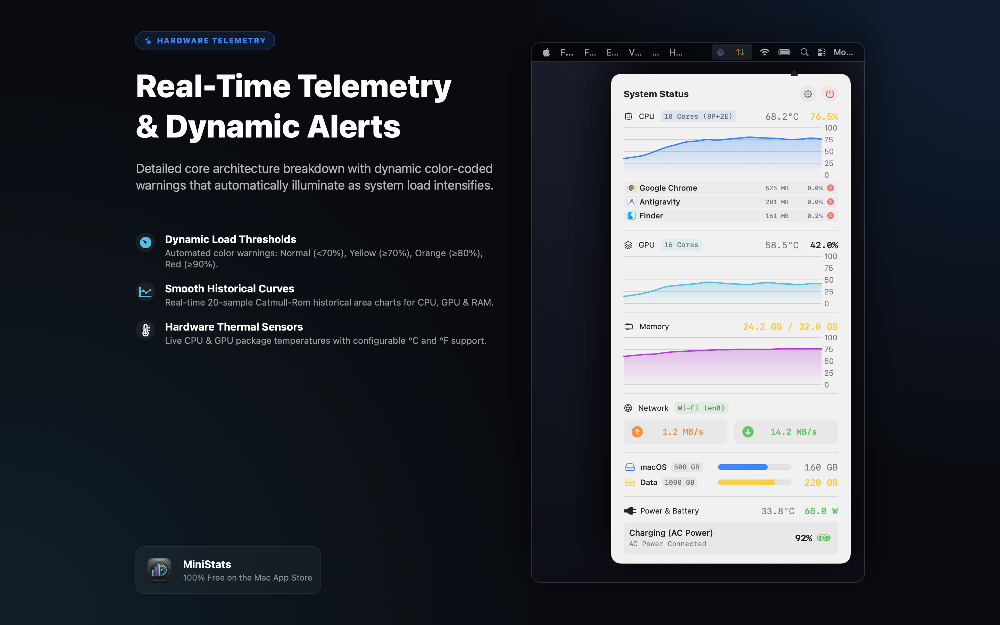
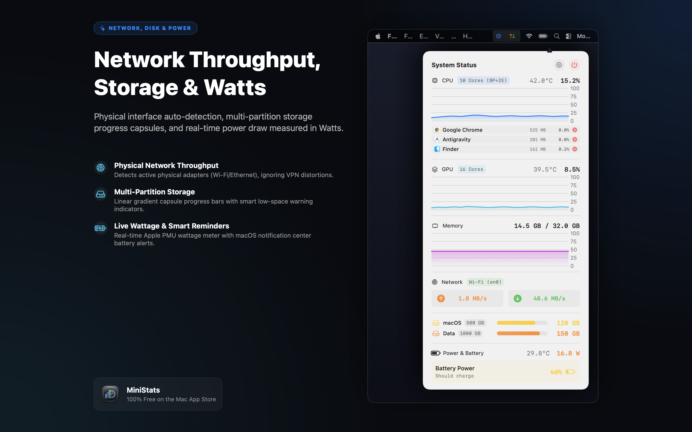

# MiniStats - Minimalist System Monitor for macOS

  

  

  
  
  
  
  

---

A clean, modern, and ultra-lightweight system monitor designed exclusively for macOS. Built 100% natively in Swift and SwiftUI, MiniStats delivers real-time hardware telemetry, live network throughput, battery charging wattage, multi-partition storage tracking, and resource-heavy process monitoring with near-zero energy consumption.

* 🍏 **Mac App Store**: [https://apps.apple.com/app/ministats-system-monitor/id6820877282](https://apps.apple.com/app/ministats-system-monitor/id6820877282)
* 🌐 **Official Website**: [https://ntt339.github.io/softs/](https://ntt339.github.io/softs/)
* 🔒 **Privacy Policy**: [https://ntt339.github.io/softs/privacy.html](https://ntt339.github.io/softs/privacy.html)
* 💻 **GitHub Repository**: [https://github.com/ntt339/softs](https://github.com/ntt339/softs)

---

## 📸 Screenshots Showcase

| Menu Bar & Dashboard Overview | Hardware Telemetry & Catmull-Rom | Network Throughput & Power Draw |
| :---: | :---: | :---: |
|  |  |  |

---

## ✨ Key Features

### 1. ⚡ 100% Native & Adaptive Polling (Ultra-low Energy)
* Built natively in **Swift 6 & SwiftUI** specifically for modern macOS.
* **Intelligent Adaptive Polling Lifecycle**: When the dashboard popover is closed (running in background), the app pauses process scanning and heavy hardware sensors, dropping background CPU usage to **0.0% – 0.5%**.
* **Driver & IPC Caching**: Caches `IOHIDEventSystemClient` ports and `SMCReader` key metadata to reduce kernel trap calls (`IOConnectCallStructMethod`) by up to 90%.

### 2. 📊 Live CPU & GPU Telemetry
* Real-time CPU and GPU percentage utilization.
* **Core Architecture Breakdown**: Identifies Performance cores vs. Efficiency cores (e.g., `8P+2E`).
* **Thermal Sensors**: Displays real-time CPU and GPU core temperatures in °C or °F.
* **Smooth Catmull-Rom Historical Curves**: Live 20-sample historical area graphs for CPU, GPU, and RAM.

### 3. 🛑 Top Running Apps & Safe Force Quit
* Live real-time ranking of top CPU-heavy and memory-consuming applications.
* Displays native application icons, app names, RAM usage in MB, and CPU %.
* **Safe Force Quit**: One-click termination button (`✕`) protected by a confirmation alert modal to safeguard unsaved work.
* Configurable to display **Top 3** or **Top 5** applications, or toggle off completely.

### 4. 🚦 Dynamic Color-Coded Load Warnings
* Visual alert intelligence that dynamically transitions colors as system load rises:
  * **< 70%**: Normal standard system color
  * **≥ 70%**: 🟡 Yellow (Notice / Warning)
  * **≥ 80%**: 🟠 Orange (High load)
  * **≥ 90%**: 🔴 Red (Critical / Peak load)
* Synchronized across Menu Bar CPU status, Dashboard headers, RAM meters, and Top Processes.

### 5. 🔋 Power, Wattage Meter & Smart Battery Reminders
* **Real-time Wattage Meter**: Measures precise power draw and charging rates in Watts (`XX.X W`) directly from Apple Silicon PMU and `AppleSmartBattery`.
* **Smart Charger Reminders**: Sends native macOS Notification Center alerts with audio when battery drops below **50%** (Notice), **40%** (Early warning), and **≤ 30%** (Critical warning) to encourage timely charging and maximize battery longevity.
* Automatically clears reminders upon plugging into AC power.
* Shows power adapter specifications, battery health percentage, and estimated remaining runtime.

### 6. 🗄️ Multi-Disk & Multi-Partition Auto-Detection
* Automatically detects and monitors all internal disks and user-mounted partitions (e.g., system partition vs. secondary data partitions).
* Modern **Apple Capsule** progress bars with smooth linear gradients.
* Dynamic low space warnings:
  * **≤ 30% Free**: Yellow
  * **≤ 20% Free**: Orange
  * **≤ 10% Free**: Red

### 7. 🌐 True Physical Network Throughput
* Real-time upload and download transfer speeds (KB/s, MB/s) with clean dedicated cards.
* **Physical Interface Auto-Detection**: Uses `SystemConfiguration` (`SCDynamicStore`) to identify genuine active physical adapters (Wi-Fi, Ethernet), ensuring VPN tunnels never distort actual hardware throughput.
* Fixed arrow indicators and centered metrics to eliminate layout jitter.

### 8. 🧠 Transparent RAM Allocation
* Real-time used versus total system memory displayed in clear, honest gigabytes (`X.X GB / Y.Y GB`), avoiding deceptive percentages caused by macOS inactive file caching.

### 9. 🎛️ Customizable Menu Bar & Central Settings
* **Customizable Menu Bar**: Toggle CPU % on/off, toggle Network speeds on/off, or show a minimal gauge icon when both are disabled.
* In-place smooth navigation to a centralized **Settings** screen (⚙️).
* Adjust autostart, temperature unit (°C / °F), process monitoring, battery alerts, and language.

### 10. 🌍 11 International Languages Built-in
Switch instantly between 11 languages without restarting the application:
* 🇬🇧 **English**
* 🇩🇪 **Deutsch** (German)
* 🇫🇷 **Français** (French)
* 🇪🇸 **Español** (Spanish)
* 🇵🇹 **Português** (Portuguese)
* 🇹🇷 **Türkçe** (Turkish)
* 🇯🇵 **日本語** (Japanese)
* 🇰🇷 **한국어** (Korean)
* 🇲🇽 **Español (México)**
* 🇩🇰 **Dansk** (Danish)
* 🇻🇳 **Tiếng Việt** (Vietnamese)

### 11. 🚀 Native Login Autostart
* Uses Apple's modern `ServiceManagement` (`SMAppService`) framework for clean, reliable launch-at-login.
* Zero background daemons, zero invasive launch agents.

### 12. 🔒 100% Free & Absolute Privacy
* **100% Free**: No paywalls, no subscriptions, no in-app purchases, no ads.
* **Completely Offline**: Fully sandboxed inside Apple's App Sandbox. Zero analytics, zero telemetry, zero network tracking.

---

## 🛠️ System Requirements & Architecture

| Parameter | Specification |
| :--- | :--- |
| **Operating System** | macOS 14.0 (Sonoma), macOS 15.0+ (Sequoia) or later |
| **Architecture** | Universal 2 Binary (`arm64` Apple Silicon M1/M2/M3/M4 & `x86_64` Intel Core) |
| **Frameworks** | Swift 6, SwiftUI, Swift Charts, IOKit, ServiceManagement, UserNotifications |
| **Memory Footprint** | ~15 – 25 MB RAM |
| **Idle CPU Usage** | 0.0% – 0.5% (Adaptive Polling) |
| **App Sandbox** | Enabled (Strict local confinement) |
| **Distribution** | [Mac App Store (id6820877282)](https://apps.apple.com/app/ministats-system-monitor/id6820877282) |

---

## 📄 License & Privacy

* Developed by **THANG TRUONG NGOC**.
* Copyright © 2026. All rights reserved.
* For more information, please read the [Privacy Policy](https://ntt339.github.io/softs/privacy.html).
